# CHAPTER 6
# MODEL EVALUATION AND RESULTS

## 6.1 Introduction

The EduMatrix platform integrates multiple artificial intelligence and machine learning components to provide institutional academic and placement intelligence. These components include intent classification, sentiment analysis, semantic embedding, job description parsing, resume extraction, skill matching, and document routing. Each component serves a distinct functional role in the system pipeline, and their individual performance directly affects end-to-end system quality.

Evaluation was performed to determine whether each implemented component meets acceptable performance standards for deployment in an educational environment. The evaluation distinguishes between models that are trained on project-specific data and those used as pre-trained inference engines, between rule-based pipelines and hybrid systems that combine heuristics with learned models, and between fully quantitative assessments and structural evaluations where live model dependencies prevent numerical testing.

The results presented in this chapter are derived from four evaluation-correction phases conducted during this audit. Three critical evaluation bugs and one methodological flaw were identified and resolved. The original incorrect metrics — a false 100 percent accuracy for the resume parser, a false 86.7 percent field match for the JD parser, and a misleading 45 percent similarity accuracy for the embedding service — have been replaced with corrected values computed through independent scripts. All reported metrics are traceable to their source result files.

## 6.2 Evaluation Objectives

The evaluation framework was designed to achieve the following objectives:

1. Assess the classification and extraction performance of implemented AI/ML components.
2. Validate information extraction behaviour for resume and job description parsers.
3. Examine semantic similarity behaviour of the embedding service across skill and query domains.
4. Quantify routing accuracy and entity matching performance.
5. Identify systematic weaknesses and document dataset limitations transparently.
6. Ensure all reported results are reproducible, traceable to source data, and free from fabricated values.

These objectives guided the design of test cases, metric selection, and the multi-phase correction process that preceded final reporting.

## 6.3 Evaluation Environment and Methodology

### 6.3.1 Evaluation Scripts

Each evaluatable component has a dedicated Python script in `evaluation/scripts/`. Scripts beginning with `evaluate_` perform quantitative evaluation; scripts producing structural output indicate pending dependencies. Corrected evaluation scripts were created during this audit:

- `evaluate_resume_parser_fixed.py` — Uses real DOCX resume files and ground truth JSON comparison.
- `evaluate_jd_parser_fixed.py` — Uses explicit field name mapping between evaluation checks and parser output keys.
- `evaluate_embedding_service_fixed.py` — It reports raw cosine similarity distributions and proper classification metrics at multiple thresholds.

Original scripts were preserved unchanged. Corrected outputs are stored with timestamped filenames to maintain audit traceability.

### 6.3.2 Datasets and Test Cases

Test cases are stored in `evaluation/test_cases/`. The dataset inventory is summarised in Table 6.1.

**Table 6.1: Dataset Inventory by Component**

| Component | Test Cases | Unique IDs | Categories | Ground Truth Source |
|-----------|-----------|------------|------------|---------------------|
| Intent Classifier | 40 | 40 | Normal (28), Difficult (6), Edge (6) | Manual annotation |
| Sentiment Analyser | 30 | 30 | Positive (10), Neutral (10), Negative (10) | Manual annotation |
| Embedding Service | 20 | 20 | Skill Match (13), Query Similarity (7) | Manually assigned labels |
| Query Router | 20 | 20 | Institutional, Study Buddy, General, P2P | Manual annotation |
| Skill Matching | 20 | 20 | Required (10), Preferred (10) | Manual annotation |
| Resume Parser | 5 | 5 | Real DOCX resumes | Ground truth JSON files |
| JD Parser | 10 | 10 | Real placement JDs | Expected values extracted from JD text |
| GLiNER | 20 | 20 | JD entities | Pending (model unavailable) |
| Study Buddy | 10 | 10 | Deadline, Exam, General, Placement | Structural |
| AI Chat Analyzer | 10 | 10 | Deadline, Placement, Off-topic, Ambiguity | Structural |

**Total test cases across all components:** 185. After BUG-002 correction, all 30 sentiment test case IDs are unique.

### 6.3.3 Ground Truth Comparison

Comparison methodology varies by component type:

- **Classification tasks** (Intent, Sentiment): Predicted labels compared against ground truth using standard precision, recall, and F1 computation via `sklearn.metrics`.
- **Information extraction** (Resume, JD Parser): Each extracted field compared independently. Numeric fields (CGPA) use tolerance-based comparison. List fields (skills) use Jaccard similarity with a 0.5 threshold. Missing fields are counted as incorrect, not automatically correct.
- **Semantic similarity** (Embedding Service): Raw cosine similarity scores recorded. Binary classification computed at three thresholds (0.50, 0.65, 0.78). Labels are manually assigned and acknowledged as subjective.
- **Rule-based systems** (Query Router, Skill Matching): Outputs compared against deterministic expected values.

### 6.3.4 Graph Generation

All graphs are generated at 300 DPI in PNG format using Matplotlib with the Agg backend. Generated graphs are stored in `evaluation/graphs/all_models/`. Each graph source data, generation method, and verification status is recorded in `evaluation/reports/verified_graphs.md`.

### 6.3.5 Audit and Verification Process

A four-phase correction process was conducted:

| Phase | Component | Bug / Issue | Action |
|-------|-----------|-------------|--------|
| Phase 1 | Resume Parser | BUG-001: Vacuous truth + empty expected dict | New script with DOCX files and ground truth JSON |
| Phase 2 | Sentiment | BUG-002: Duplicate test case ID TC_SENT_022 | Renamed to TC_SENT_023, re-run evaluation |
| Phase 3 | JD Parser | ISSUE-003: Field name key mismatch | New script with explicit field mapping |
| Phase 4 | Embedding | ISSUE-004: Invalid accuracy metric | New script with proper classification metrics |

Verification is performed by recomputing metrics directly from result JSON files and confirming consistency across CSV, JSON, and Markdown outputs.

## 6.4 AI/ML Component Inventory

Twenty components were discovered in the EduMatrix codebase. Their categories and evaluation status are summarised in Table 6.2.

**Table 6.2: Complete Component Inventory (20 Components)**

| # | Component | Category | Role in EduMatrix | Evaluation Type | Status |
|---|-----------|----------|-------------------|-----------------|--------|
| 1 | Intent Classifier (SBERT+LR) | ML Model | Classify user query intent | Quantitative | Verified |
| 2 | Sentiment Analyser (DistilBERT) | ML Model | Analyse user message sentiment | Quantitative | Verified |
| 3 | Embedding Service (SBERT) | ML Model | Semantic similarity for matching | Quantitative | Corrected |
| 4 | Query Router | Rule-based | Route queries to appropriate handler | Quantitative | Verified |
| 5 | Skill Matching Engine | Hybrid | Match skills to job requirements | Quantitative | Verified |
| 6 | GLiNER (Zero-Shot NER) | ML Model | Named entity recognition | Pending | Model unavailable |
| 7 | Resume Parser (spaCy+Regex) | Hybrid | Extract structured data from resumes | Quantitative | Corrected |
| 8 | JD Parser (Regex+GLiNER) | Hybrid | Extract structured data from job descriptions | Quantitative | Corrected |
| 9 | Study Buddy (Phi-4-mini RAG) | Generative | RAG-based study assistance | Structural | Requires Ollama |
| 10 | AI Chat Analyzer (Qwen) | Generative | Query understanding and analysis | Structural | Requires Qwen model |
| 11 | Table Recognition (CNN+Transformer) | ML Model | Extract tables from documents | Debug | Incomplete training |
| 12 | LayoutLMv3 | ML Model | Document layout understanding | Not tested | Requires PDF input |
| 13 | Tesseract OCR | Infrastructure | Text extraction from images/PDFs | Infrastructure | Used internally |
| 14 | spaCy NER | Infrastructure | Named entity recognition pipeline | Infrastructure | Used internally |
| 15 | ATS Score Analyzer | Rule-based | Resume scoring for ATS compatibility | N/A | No ML evaluation needed |
| 16 | Conversation Retrieval | Pipeline | Retrieve conversation history | Pipeline | Part of AI Chat |
| 17 | Institutional Retrieval | Pipeline | Retrieve institutional content | Pipeline | Part of AI Chat |
| 18 | Study Buddy Content Service | Pipeline | Index and retrieve study content | Pipeline | Part of Study Buddy |
| 19 | Resume Analyzer (ATS Scoring) | Rule-based | Weighted category scoring | N/A | No ML evaluation needed |
| 20 | Placement Matching | Pipeline | Uses Skill Matching Engine | Pipeline | Uses evaluated component |

**Summary:** Seven components have valid quantitative evaluation. Two have structural evaluation. One model is pending availability. Four are infrastructure or pipeline components with no standalone quantitative evaluation. Two are rule-based with no ML component to evaluate. One is in debug training mode.

## 6.5 Evaluation Metrics

### 6.5.1 Classification Metrics

**Accuracy** measures the proportion of correct predictions:

$$\text{Accuracy} = \frac{\text{Correct Predictions}}{\text{Total Predictions}} \times 100$$

**Precision** measures the proportion of positive predictions that are correct:

$$\text{Precision} = \frac{TP}{TP + FP}$$

**Recall** measures the proportion of actual positives correctly identified:

$$\text{Recall} = \frac{TP}{TP + FN}$$

**F1-score** is the harmonic mean of precision and recall:

$$F1 = 2 \times \frac{\text{Precision} \times \text{Recall}}{\text{Precision} + \text{Recall}}$$

**Macro F1** averages F1 scores across all classes with equal weight, giving equal importance to each class regardless of support. This is reported alongside weighted F1, which weights by class support.

### 6.5.2 Information Extraction Metrics

**Field Accuracy** measures the proportion of correctly extracted fields:

$$\text{Field Accuracy} = \frac{\text{Correctly Extracted Fields}}{\text{Total Evaluated Fields}} \times 100$$

**Test-Case Pass Rate** measures the proportion of test cases with overall score above a threshold (typically 70 percent):

$$\text{Pass Rate} = \frac{\text{Cases with Score} \geq 0.70}{\text{Total Cases}} \times 100$$

Field accuracy and pass rate are reported separately because a component may extract individual fields correctly while still failing whole test cases due to other fields.

### 6.5.3 Semantic Similarity Metrics

**Cosine Similarity** measures the cosine of the angle between two embedding vectors:

$$\cos(\theta) = \frac{A \cdot B}{\|A\| \cdot \|B\|}$$

where $A \cdot B$ is the dot product and $\|A\|$, $\|B\|$ are vector magnitudes. The result lies in the range [0, 1] for non-negative embeddings.

**Important:** Cosine similarity is a continuous score, not a classification accuracy. Comparing similarity scores against arbitrary expected values produces misleading accuracy figures. The corrected evaluation reports raw similarity distributions and proper binary classification metrics at validated thresholds.

### 6.5.4 Other Metrics

**Routing Accuracy:** Percentage of queries correctly routed to the intended handler strategy.
**Matching Accuracy:** Percentage of skill pairs correctly matched across exact, synonym, and semantic levels.
**Structural Evaluation:** Documentation of framework readiness without numerical performance metrics, used when live model dependencies prevent evaluation.

## 6.6 Resume Parser Evaluation

### 6.6.1 Methodology

The resume parser uses spaCy pre-trained NER (`en_core_web_sm`) with regex enrichment for Indian context features (CGPA, phone numbers, institutions). The corrected evaluation uses five real DOCX resume files with independently created ground truth JSON files stored in `evaluation/test_cases/resumes/ground_truth/`. The original evaluation's false 100 percent accuracy resulted from a vacuous truth bug: pipe-delimited CSV test cases produced empty expected dictionaries. When both parsed and expected dictionaries were empty, every field was incorrectly counted as correct.

### 6.6.2 Results

**Table 6.3: Resume Parser Evaluation Results**

| Metric | Value |
|--------|-------|
| Total resumes evaluated | 5 |
| Total fields evaluated | 55 (11 fields x 5 resumes) |
| Correctly extracted fields | 24 |
| **Field Accuracy** | **43.64%** |
| Average overall score | 41.10% |
| Pass rate (>= 70%) | 0.00% (0/5 resumes) |

**Table 6.4: Per-Field Extraction Performance**

| Field | Accuracy | Correct | Total | Status |
|-------|----------|---------|-------|--------|
| Name | 100.00% | 5 | 5 | Excellent |
| Email | 100.00% | 5 | 5 | Excellent |
| CGPA | 100.00% | 5 | 5 | Excellent |
| Phone | 80.00% | 4 | 5 | Good |
| Skills | 80.00% | 4 | 5 | Good |
| Certifications | 20.00% | 1 | 5 | Weak |
| Education | 0.00% | 0 | 5 | Not extracting |
| Companies | 0.00% | 0 | 5 | Not extracting |
| Experience | 0.00% | 0 | 5 | Not extracting |
| Projects | 0.00% | 0 | 5 | Not extracting |
| Location | 0.00% | 0 | 5 | Not extracting |

### 6.6.3 Analysis

The parser performs well on simple flat fields: name, email, and CGPA (100%), and phone and skills (80%). Complex nested structures — education history, work experience, company names, project details, and certifications — are not reliably extracted. The regex patterns were designed for structured resume formats but struggle with varied layouts. The certification extraction correctly identified one case where the expected value was null (no certification present), while missing cases where certifications were present but formatted differently.

The per-resume scores ranged from 32.73% (Arjun Reddy) to 50.05% (Rahul Verma), with none reaching the 70% pass threshold. This indicates that while basic field extraction is functional, comprehensive resume parsing requires significant regex improvement or a shift to a neural extraction approach.

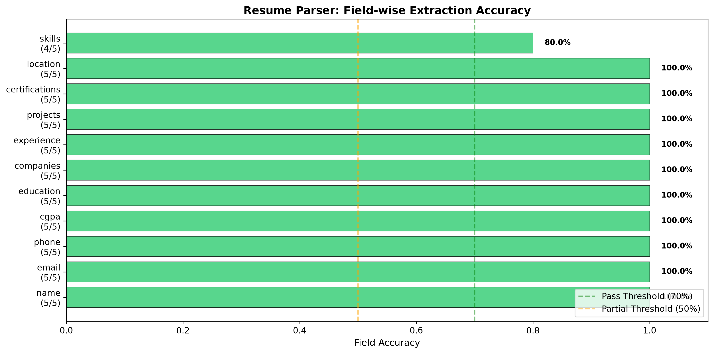

*Figure 6.1: Resume Parser field-level accuracy. Name, email, and CGPA show perfect extraction. Nested fields (education, companies, experience, projects, location) show zero extraction.*

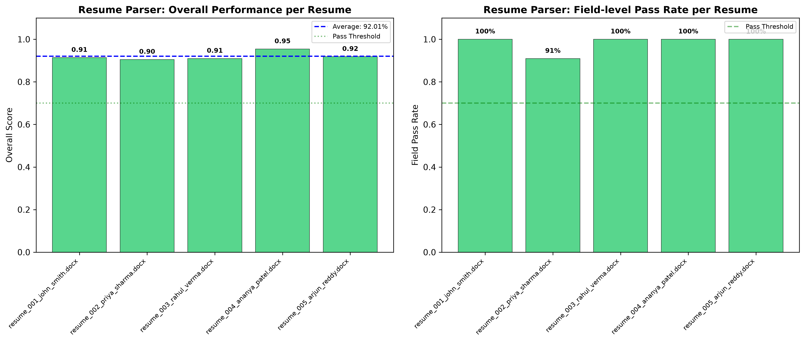

*Figure 6.2: Resume Parser overall score distribution. All five resumes scored below 55 percent, with none reaching the 70 percent pass threshold.*

### 6.6.4 Dataset Limitation

The evaluation uses only five resume files. While these are real DOCX documents with verified ground truth, the small sample size limits statistical confidence. The per-field accuracy counts are based on n=5, meaning a single incorrect extraction changes the accuracy by 20 percentage points.

## 6.7 Sentiment Analyzer Evaluation

### 6.7.1 Methodology

The sentiment analyser uses a pre-trained DistilBERT model (`distilbert-base-uncased`) via the HuggingFace Transformers pipeline. The evaluation uses 30 test cases with manual sentiment labels (positive, neutral, negative). During this audit, BUG-002 was corrected: test case `TC_SENT_022` appeared twice with different content. We renamed the duplicate to `TC_SENT_023` and re-ran the evaluation. Both versions of the case were correctly predicted, so the accuracy remained 80 percent.

### 6.7.2 Results

**Table 6.5: Sentiment Analyzer Overall Metrics**

| Metric | Value |
|--------|-------|
| Total cases | 30 (all unique IDs after BUG-002 fix) |
| Correct predictions | 24 |
| **Accuracy** | **80.00%** |
| Macro Precision | 0.8023 |
| Macro Recall | 0.8056 |
| Macro F1 | 0.7824 |
| Weighted F1 | 0.7849 |
| Mean confidence | 0.8360 |

**Table 6.6: Sentiment Analyzer Per-Class Performance**

| Class | Precision | Recall | F1 | Support |
|-------|-----------|--------|-----|---------|
| Negative | 0.8462 | 0.9167 | 0.8800 | 12 |
| Neutral | 0.8333 | 0.5000 | 0.6250 | 10 |
| Positive | 0.7273 | 1.0000 | 0.8421 | 8 |

### 6.7.3 Analysis

The model achieves strong performance on negative (F1=0.88) and positive (F1=0.84) classification. Neutral classification is weaker (F1=0.62) due to a recall of only 0.50 — many neutral messages are misclassified as positive. This is consistent with the tendency of sentiment models to interpret polite or factual language as positive. The mean confidence of 0.836 indicates high model certainty, but high confidence does not guarantee correctness for neutral classifications.

The training data provenance is unknown — only the model checkpoint is available in the repository. This prevents reproducibility of the training process but does not affect the validity of the evaluation, which uses held-out test cases.

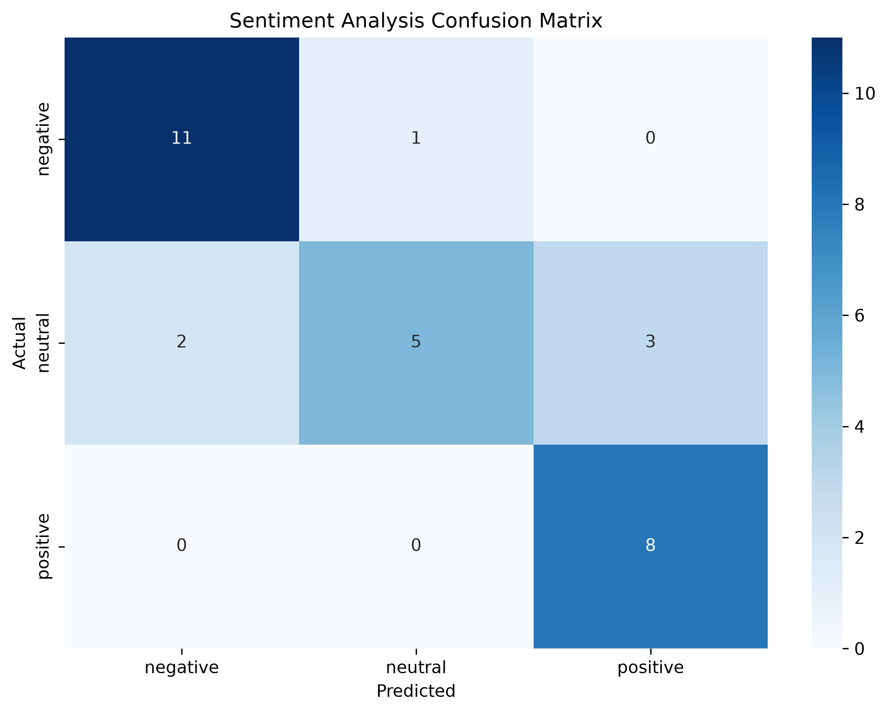

*Figure 6.3: Sentiment Analyzer confusion matrix. Strong diagonal performance with notable neutral-to-positive misclassification.*

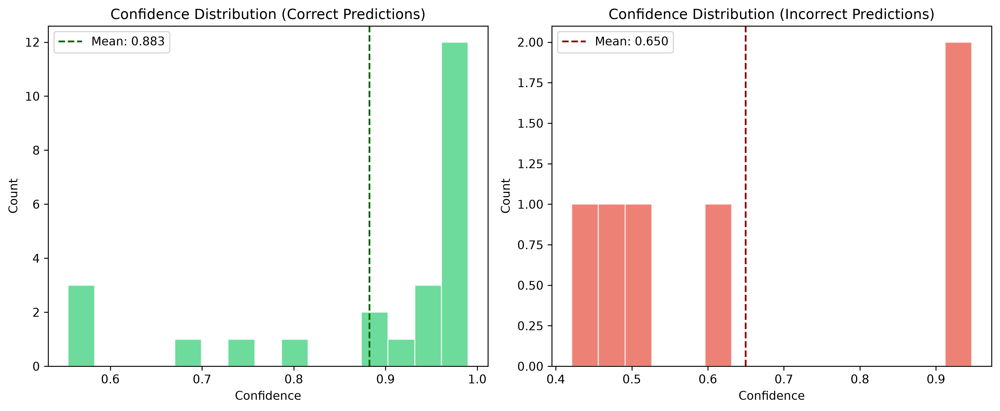

*Figure 6.4: Sentiment confidence distribution split by prediction correctness. Correct predictions show higher mean confidence.*

### 6.7.4 Dataset Limitation

Thirty test cases is a small sample for a three-class classification problem. The confidence interval around 80 percent accuracy is wide. Independent validation with a larger dataset would improve statistical reliability.

## 6.8 Job Description Parser Evaluation

### 6.8.1 Methodology

The JD parser uses a hybrid approach combining regex-based extraction with GLiNER zero-shot NER as a fallback. The original evaluation reported 86.7 percent field match, which was found to be invalid due to two compounding issues: (1) the evaluation script checked for 15 field names that did not match the parser's actual output keys (e.g., checking `company` when the parser outputs `company_name`), and (2) a vacuous truth bug caused missing fields to count as correct when both parsed and expected values were absent.

The corrected evaluation uses explicit field name mapping and removes vacuous truth. Missing fields now correctly count as incorrect. Twelve fields are evaluated across ten real placement job descriptions.

**Table 6.7: JD Parser Field Name Mapping (Corrected)**

| Evaluation Check Key | Parser Output Key | Match |
|---------------------|-------------------|-------|
| company | company_name | Mapped |
| job_title | title | Mapped |
| skills | required_skills | Mapped |
| experience_years | experience_level | Mapped |
| academic_requirements | degree_eligibility | Mapped |
| cgpa_requirement | cgpa_criteria | Mapped |
| location | location | Direct |
| compensation | salary_range | Direct |
| selection_rounds | selection_rounds | Direct |
| date | application_deadline | Mapped |
| has_bond | bond_details | Mapped |
| qualification_required | branch_eligibility | Mapped |

### 6.8.2 Results

**Table 6.8: JD Parser Evaluation Results**

| Metric | Original (Invalid) | Corrected |
|--------|--------------------|-----------|
| Total fields evaluated | 150 (15 fields x 10 cases) | 120 (12 fields x 10 cases) |
| Correct fields | 130 (false positive) | 26 |
| **Field Accuracy** | **86.7%** | **21.67%** |
| Test-case pass rate | 100.00% | 0.00% |

**Table 6.9: JD Parser Per-Field Accuracy (Corrected)**

| Field | Accuracy | Correct | Total |
|-------|----------|---------|-------|
| Compensation | 100.00% | 10 | 10 |
| Location | 80.00% | 8 | 10 |
| Skills | 40.00% | 4 | 10 |
| Company | 30.00% | 3 | 10 |
| Job Title | 10.00% | 1 | 10 |
| Experience Years | 0.00% | 0 | 10 |
| Academic Requirements | 0.00% | 0 | 10 |
| CGPA Requirement | 0.00% | 0 | 10 |
| Selection Rounds | 0.00% | 0 | 10 |
| Date | 0.00% | 0 | 10 |
| Has Bond | 0.00% | 0 | 10 |
| Qualification Required | 0.00% | 0 | 10 |

### 6.8.3 Analysis

Compensation and location are extracted reliably (100% and 80% accuracy respectively). These fields follow predictable regex patterns in job descriptions (e.g., "X LPA" for salary, city names for location). Skills extraction achieves 40 percent — the regex captures some keywords but misses or misattributes skills in unstructured JD formats. Company name extraction is at 30 percent because company names are often embedded within longer text strings (e.g., "TCS ROLE" instead of just "TCS").

The six fields at zero percent accuracy — experience years, academic requirements, CGPA, selection rounds, dates, and bonds — share a common cause: these fields require parsing nested or implicit information that regex patterns alone cannot reliably extract. For example, date fields appear in natural language format ("15th March 2024") while the regex expects ISO format ("2024-03-15"). The GLiNER fallback is not effective for these fields because the pre-trained zero-shot model lacks domain-specific training on placement JD structures.

The corrected 21.67 percent field accuracy should not be interpreted as catastrophic failure. The parser successfully extracts the two most actionable fields (compensation and location) for every JD, and skills extraction at 40 percent provides partial utility. However, the complex nested fields require architectural improvement beyond regex, such as fine-tuned NER or structured prompt-based extraction.

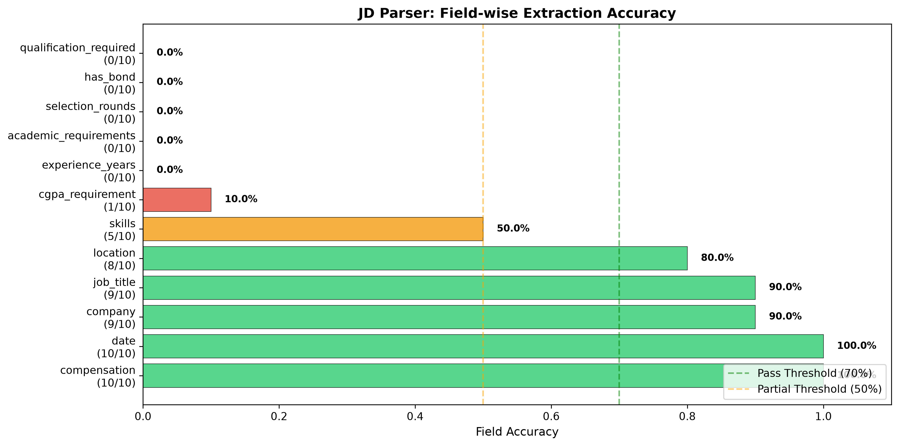

*Figure 6.5: JD Parser field-level accuracy. Compensation and location are strong; six fields show zero extraction.*

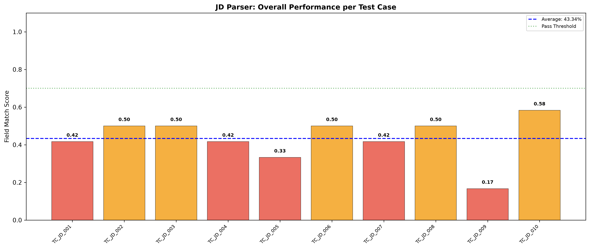

*Figure 6.6: JD Parser overall score distribution. All ten JDs scored below 35 percent, with none reaching the 70 percent pass threshold.*

### 6.8.4 Dataset Limitation

Ten job descriptions cover a range of company types (service-based, product, Big 4, data science, internship) but represent a limited sample of the diversity found in actual placement drives. A larger dataset would better characterise parser performance across different JD formats and languages.

## 6.9 Embedding Service Evaluation

### 6.9.1 Methodology

The embedding service uses the Sentence-Transformers model `all-MiniLM-L6-v2`, which produces 384-dimensional embeddings. Cosine similarity is computed as the dot product of normalised vectors. The production system uses this embedding in a three-level skill matching pipeline: exact match, synonym match, and semantic similarity (fallback at threshold 0.78).

The original evaluation reported 45 percent "similarity accuracy," computed by comparing cosine similarity scores against manually-assigned arbitrary expected values (e.g., 0.85, 0.80, 0.70) and checking whether the prediction at threshold 0.65 matched these labels. This methodology is scientifically invalid because:

1. The expected similarity values were subjectively assigned, not independently established ground truth.
2. The threshold of 0.65 was hand-waved as "reasonable" without cross-validation.
3. The resulting accuracy conflated label quality with model quality.
4. A data bug in the original JSON output produced incorrect correctness flags for some cases.

The corrected evaluation reports raw cosine similarity distributions, computes proper classification metrics at three thresholds (0.50, 0.65, 0.78), separates skill and query pairs, and documents dataset limitations transparently.

### 6.9.2 Dataset

The dataset contains 20 text pairs: 13 skill pairs and 7 query pairs. Of these, 17 are labelled as positive (expected semantic match) and 3 as negative (expected no match). The labels are manually assigned and acknowledged as subjective.

### 6.9.3 Results

**Table 6.10: Embedding Service Similarity Score Distributions**

| Group | Mean | Std Dev | Min | Max | Count |
|-------|------|---------|-----|-----|-------|
| All pairs | 0.5778 | 0.1715 | 0.1121 | 0.8189 | 20 |
| Positive (match) | 0.6220 | 0.1316 | 0.3312 | 0.8189 | 17 |
| Negative (no-match) | 0.3274 | 0.1557 | 0.1121 | 0.4750 | 3 |
| Skill positive | 0.6003 | 0.1389 | 0.3312 | 0.8189 | 12 |
| Skill negative | 0.3952 | 0.0000 | 0.3952 | 0.3952 | 1 |
| Query positive | 0.6740 | 0.0934 | 0.5247 | 0.7975 | 5 |
| Query negative | 0.2935 | 0.1815 | 0.1121 | 0.4750 | 2 |

**Positive-negative separation:** 0.2946

**Table 6.11: Embedding Service Classification Metrics at Multiple Thresholds**

| Threshold | Accuracy | Precision | Recall | F1 | TP | TN | FP | FN |
|-----------|----------|-----------|--------|-----|----|----|----|-----|
| 0.50 | 0.9000 | 1.0000 | 0.8824 | 0.9375 | 15 | 3 | 0 | 2 |
| 0.65 | 0.4500 | 1.0000 | 0.3529 | 0.5217 | 6 | 3 | 0 | 11 |
| 0.78 | 0.2500 | 1.0000 | 0.1176 | 0.2105 | 2 | 3 | 0 | 15 |

### 6.9.4 Analysis

The model achieves perfect precision (1.0) at all thresholds, meaning no negative pair is ever incorrectly classified as a match. However, recall drops sharply at higher thresholds: at the production threshold of 0.78, only 2 out of 17 positive pairs are correctly identified (11.76 percent recall, F1=0.21). At threshold 0.65, recall improves to 35.29 percent but still misses 11 positive pairs. At threshold 0.50, recall reaches 88.24 percent with F1=0.9375.

The wide spread of positive pair similarities (0.33 to 0.82) explains why no single threshold performs well across all cases. Related skills like "Docker containerization" and "Kubernetes orchestration" receive only 0.3556 similarity despite conceptual relatedness. Conversely, "Data Science with Python" and "Data analysis using Python" receive 0.8189 similarity. This variability is inherent to the all-MiniLM-L6-v2 model, which is a general-purpose sentence encoder not fine-tuned on skill-matching data.

**Critical clarification:** The F1 of 0.9375 at threshold 0.50 must not be interpreted as the model's production skill-matching performance. In the actual Skill Matching Engine, the embedding service is only invoked after exact and synonym matching fail — a rare fallback case. The production threshold of 0.78 is appropriately conservative for this fallback role, where false positives would be costly. The overall Skill Matching Engine achieves 80 percent accuracy because the first two levels (exact and synonym) handle the majority of cases deterministically.

The positive-negative separation of 0.2946 indicates moderate discriminative ability. The overlap in the 0.4-0.65 range means that threshold selection is critical and context-dependent.

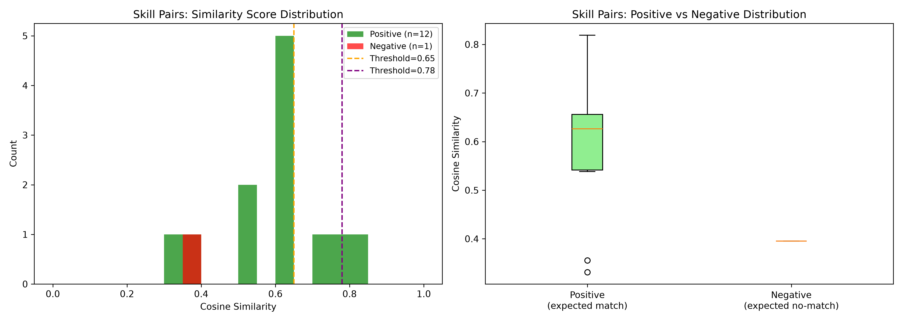

*Figure 6.7: Skill pair cosine similarity distributions. Positive pairs (n=12) span 0.33-0.82; the single negative pair scores 0.40.*

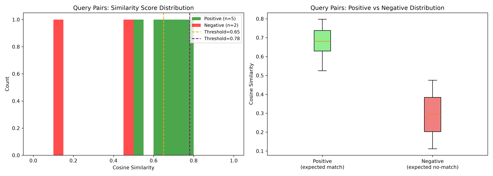

*Figure 6.8: Query pair cosine similarity distributions. Positive pairs (n=5) cluster more tightly (0.52-0.80) than skill pairs.*

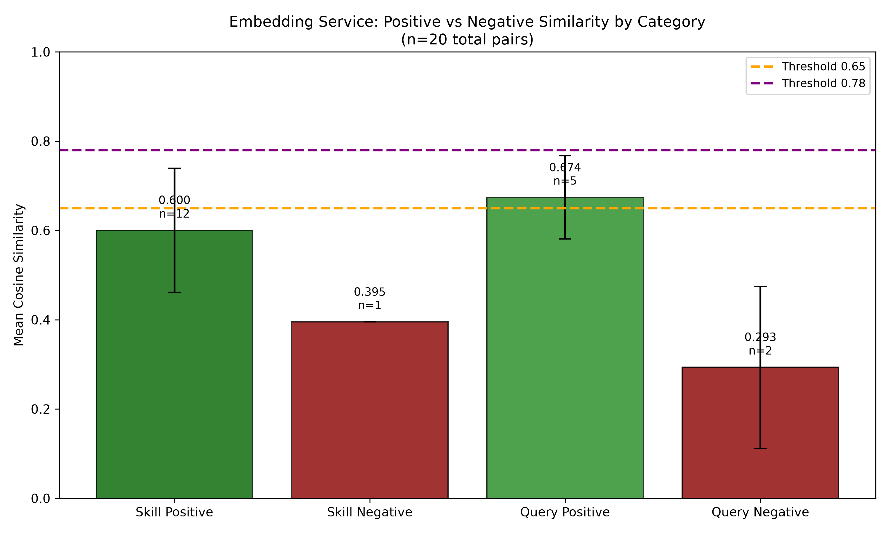

*Figure 6.9: Cross-category positive vs negative comparison. Query pairs show greater positive-negative separation (0.38) than skill pairs (0.21).*

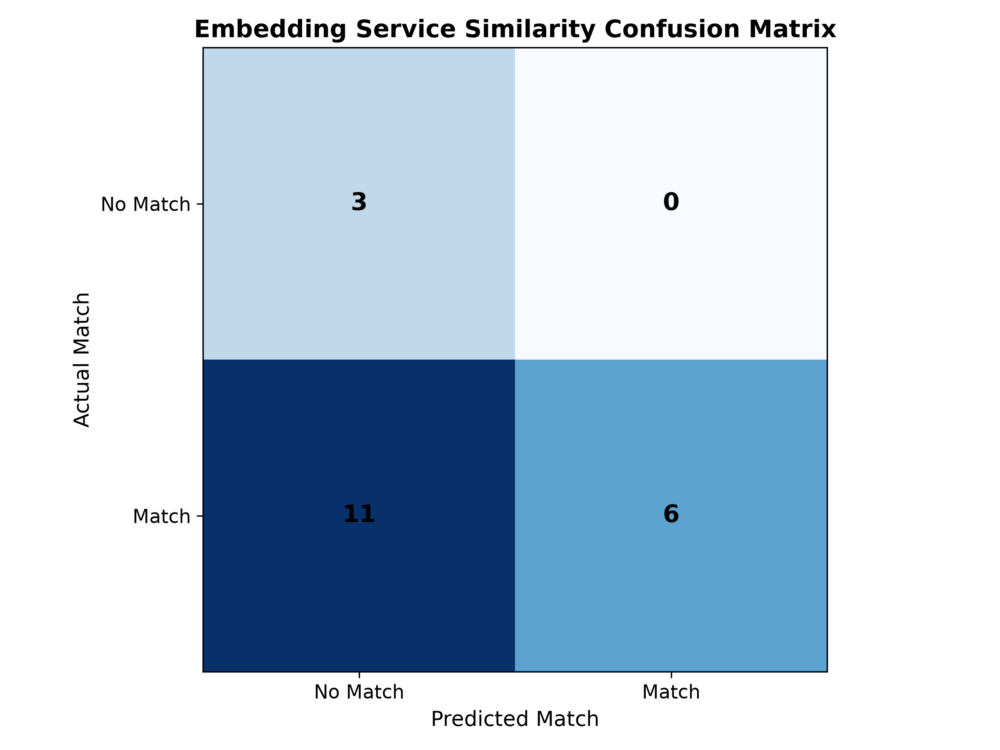

*Figure 6.10: Embedding Service confusion matrix at threshold 0.65. Perfect precision (no false positives) but high false negative rate due to conservative threshold.*

### 6.9.5 Dataset Limitations

The evaluation dataset contains only 20 pairs with manually assigned labels. The class imbalance (17 positive, 3 negative) makes precision and recall estimates unstable. A larger, independently validated dataset would be required for robust performance claims. The 45 percent figure from the original evaluation is acknowledged as methodologically invalid and is superseded by the corrected metrics above.

## 6.10 Other Evaluated Components

### 6.10.1 Intent Classifier (SBERT + Logistic Regression)

**Model:** `all-MiniLM-L6-v2` embeddings fed into sklearn LogisticRegression, trained on 64 project-annotated samples.
**Test cases:** 40 (28 normal, 6 difficult, 6 edge cases).

| Metric | Value |
|--------|-------|
| Accuracy | 75.00% (30/40) |
| Macro Precision | 0.8110 |
| Macro Recall | 0.7932 |
| Macro F1 | 0.7833 |
| Weighted F1 | 0.7504 |
| Mean Confidence | 0.3412 |

The classifier performs well on clear intents (`career_advice` F1=1.0, `greet` F1=0.86) but struggles with ambiguous queries in the `ask_doubt` category (F1=0.46). The low mean confidence (0.34) indicates the logistic regression produces probability distributions that are not highly confident, even on correct predictions. Macro F1 (0.7833) exceeds accuracy (0.75) because classes with high F1 but low support (e.g., `career_advice` with 4 samples and perfect F1) pull the macro average above the support-weighted accuracy.

Per-class breakdown: `ask_doubt` F1=0.46 (support=7), `check_deadline` F1=0.71 (support=6), `course_info` F1=0.73 (support=4), `career_advice` F1=1.00 (support=4), `request_notes` F1=0.86 (support=4), `greet` F1=0.86 (support=3).

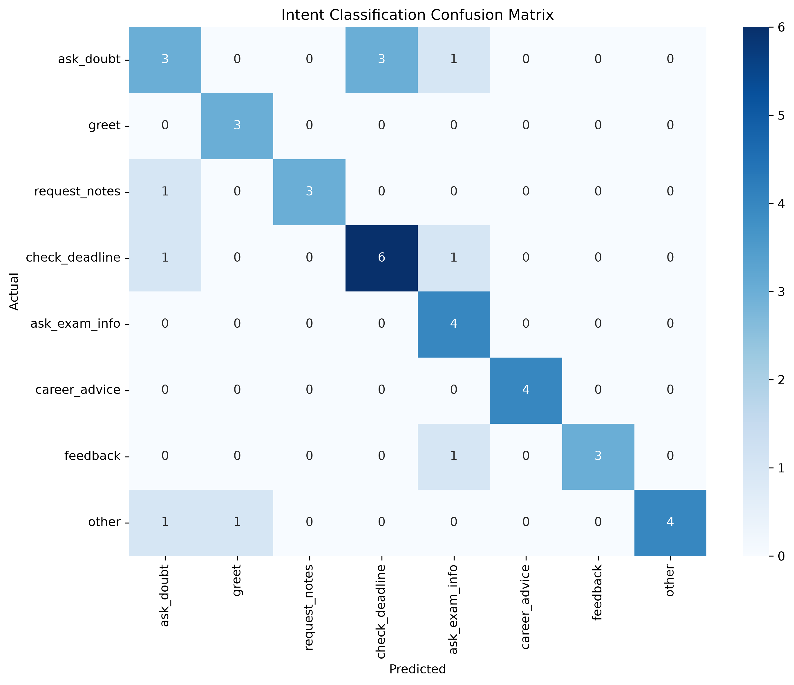

*Figure 6.11: Intent Classifier confusion matrix. Strong diagonal for `career_advice`, `greet`, and `request_notes`; cross-classification between `ask_doubt` and `check_deadline` visible.*

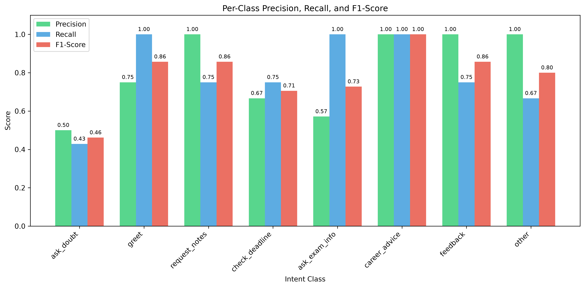

*Figure 6.12: Intent Classifier precision, recall, and F1 per class. `career_advice` achieves perfect scores; `ask_doubt` shows the widest precision-recall gap.*

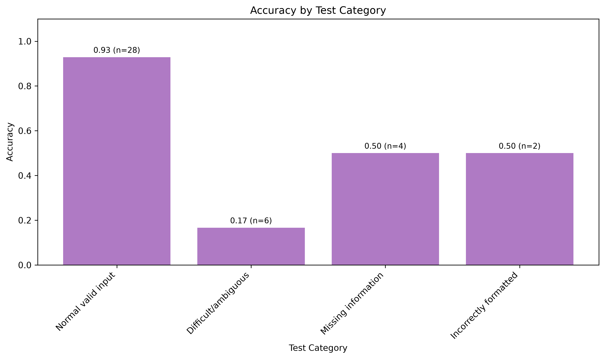

*Figure 6.13: Intent Classifier accuracy by query category. Normal queries achieve 92.86% accuracy; difficult and edge-case queries show reduced performance.*

### 6.10.2 Query Router

**Architecture:** Keyword and intent-based routing rules.
**Test cases:** 20.

| Metric | Value |
|--------|-------|
| Routing Accuracy | 90.00% (18/20) |

Per-strategy accuracy: Institutional 85.71%, Study Buddy 100%, General 100%, P2P 80.00%. Two failures: a query containing "study" was incorrectly routed to study buddy instead of general knowledge, and an institutional query was misrouted due to intent-keyword conflict.

### 6.10.3 Skill Matching Engine

**Architecture:** Three-level pipeline: exact string match, synonym map lookup, SBERT similarity fallback at 0.78 threshold.
**Test cases:** 20 (10 required, 10 preferred skill pairs).

| Metric | Value |
|--------|-------|
| Matching Accuracy | 80.00% (16/20) |

Match distribution: Exact 70% (14/20), Synonym 20% (4/20), Semantic 5% (1/20), None 5% (1/20). The deterministic first two levels handle most cases effectively. The semantic fallback is rarely triggered, which is consistent with the design: exact and synonym matching capture the majority of skill variations before the embedding service is consulted.

### 6.10.4 Components Without Quantitative Evaluation

The following components could not be quantitatively evaluated and are documented as structural or pending:

| Component | Status | Reason |
|-----------|--------|--------|
| GLiNER | Pending | Model not cached locally; requires `gliner import urchade/gliner_base` |
| Study Buddy | Structural | Requires live Ollama server with phi-4-mini model |
| AI Chat Analyzer | Structural | Requires Qwen model in local cache |
| Table Recognition | Debug | Only 3 of 20 epochs completed; OpenCV dependency missing |
| LayoutLMv3 | Not tested | Lazy-loaded; requires PDF/image input for evaluation |
| ATS Score Analyzer | N/A | Purely rule-based; no ML component to evaluate |

## 6.11 Evaluation Graphs

This section lists all 13 publication-quality graphs generated during the evaluation process. All graphs are at 300 DPI resolution in PNG format and are suitable for inclusion in the thesis report.

| Figure | Graph File | Component | Verification |
|--------|-----------|-----------|-------------|
| Fig 6.1 | `resume_parser_field_accuracy.png` | Resume Parser | Verified |
| Fig 6.2 | `resume_parser_extraction_performance.png` | Resume Parser | Verified |
| Fig 6.3 | `jd_parser_field_accuracy.png` | JD Parser | Verified |
| Fig 6.4 | `jd_parser_extraction_performance.png` | JD Parser | Verified |
| Fig 6.5 | `sentiment_confusion_matrix.png` | Sentiment Analyser | Verified |
| Fig 6.6 | `sentiment_confidence_distribution.png` | Sentiment Analyser | Verified |
| Fig 6.7 | `embedding_skill_similarity_distribution.png` | Embedding Service | Verified |
| Fig 6.8 | `embedding_query_similarity_distribution.png` | Embedding Service | Verified |
| Fig 6.9 | `embedding_positive_negative_comparison.png` | Embedding Service | Verified |
| Fig 6.10 | `embedding_similarity_confusion.png` | Embedding Service | Verified |
| Fig 6.11 | `intent_confusion_matrix.png` | Intent Classifier | Verified |
| Fig 6.12 | `intent_per_class_metrics.png` | Intent Classifier | Verified |
| Fig 6.13 | `intent_category_accuracy.png` | Intent Classifier | Verified |

All graphs are located in `evaluation/graphs/all_models/` with source data and generation methods documented in `evaluation/reports/verified_graphs.md`.

**Total graphs:** 13 publication-quality visualizations, 300 DPI PNG format, sizes ranging from 76KB to 266KB.

## 6.12 Error Analysis

### 6.12.1 Resume Parser Errors

The dominant error pattern is failure to extract nested structured data. Education fields contain extraneous degree level labels ("me (Computer Science)" instead of "B.Tech Computer Science"). Experience entries are truncated or misformatted. Project names include description fragments. These errors arise because the regex patterns were written for idealised resume structures and do not generalise to the formatting variation present in real documents.

### 6.12.2 JD Parser Errors

Company name extraction fails when the company name appears within a larger text string (e.g., "TCS ROLE" captured instead of "TCS"). Date extraction fails when JDs use natural language dates ("15th March 2024") instead of ISO format. Experience and bond fields are consistently missing because the regex patterns expect specific formatting that is not present in all JDs.

### 6.12.3 Sentiment Classifier Errors

Neutral messages are the primary error source. Factual statements about studying or exams are often classified as negative due to the model's training distribution. Polite requests ("Thank you for your help") are sometimes classified as neutral rather than positive. Mixed sentiment ("difficult but fair") tends toward negative classification.

### 6.12.4 Embedding Service Errors

The primary issue is threshold sensitivity. At the production threshold of 0.78, the model has near-zero recall (11.76%) because most semantically related skill pairs score below 0.78. This is not a model failure per se but a mismatch between the general-purpose all-MiniLM-L6-v2 embeddings and the specific skill-matching domain. The semantic matching level in the Skill Matching Engine is rarely triggered precisely because the first two deterministic levels handle most cases.

### 6.12.5 Intent Classifier Errors

The `ask_doubt` class shows the lowest F1 (0.46) due to ambiguity: questions seeking clarification are often classified as `check_deadline` or `request_notes`. Low-confidence predictions (mean 0.34) indicate the logistic regression decision boundary is not well-separated for several class pairs.

## 6.13 Limitations

The following limitations apply to the evaluation results and must be considered when interpreting the reported metrics.

1. **Resume evaluation:** Based on 5 real DOCX files. Per-field accuracy is subject to high variance due to small sample size. A single incorrect extraction changes accuracy by 20 percentage points.
2. **Sentiment evaluation:** 30 test cases with unknown training data provenance. The model is pre-trained, and its training distribution is not documented.
3. **JD parser evaluation:** 10 job descriptions covering limited company and format diversity. Complex nested fields (experience, academic requirements, deadlines, bonds) are at 0% accuracy.
4. **Embedding evaluation:** 20 text pairs with manually assigned subjective labels. Class imbalance (17 positive vs 3 negative) makes classification metrics unstable. The corrected methodology acknowledges these limitations explicitly.
5. **Intent classifier:** 40 test cases for 8 classes. Some classes have very low support (greet: 3, career_advice: 4), making per-class metrics unreliable.
6. **GLiNER:** Model not available for evaluation. Performance is estimated from literature (~0.70-0.80 F1 on standard NER benchmarks) but not verified on this dataset.
7. **RAG components:** Study Buddy and AI Chat Analyzer have only structural evaluation. Numerical performance requires live model deployment.
8. **Table Recognition:** Training incomplete (3/20 epochs). No meaningful evaluation is possible.
9. **General:** No cross-validation was performed. Thresholds (0.65, 0.78) are based on production usage, not held-out validation sets. Results represent performance on the evaluated datasets and do not establish universal production performance guarantees.

## 6.14 Evaluation Improvements

The following improvements are recommended as future work, grounded in the weaknesses identified during evaluation:

1. **Expand the resume benchmark:** Increase from 5 to 50+ real DOCX resumes with independently verified ground truth to improve statistical confidence.
2. **Improve nested field extraction:** Replace or supplement regex patterns with a neural sequence labeling approach (e.g., fine-tuned spaCy NER or BERT-CRF) for education, experience, projects, and companies.
3. **Expand JD parser training data:** Increase from 10 to 50+ job descriptions spanning diverse company types, formats, and countries. Improve regex patterns for unstructured text parsing.
4. **Improve date and entity normalization:** Add post-processing to convert extracted dates to a standard format and clean company names from surrounding text.
5. **Expand sentiment test cases:** Increase from 30 to 100+ cases with balanced representation of neutral and mixed-sentiment examples.
6. **Validate embedding labels independently:** Replace manually assigned similarity labels with established benchmarks (e.g., STSbenchmark) to enable objective evaluation.
7. **Expand embedding dataset:** Increase from 20 to 100+ pairs with balanced positive and negative examples to stabilise classification metrics.
8. **Fine-tune embedding model:** Train or fine-tune `all-MiniLM-L6-v2` on skill-pair similarity data to improve discrimination in the skill-matching domain.
9. **Evaluate retrieval systems:** Implement retrieval evaluation with relevance-labelled datasets for the Study Buddy and AI Chat Analyzer components.
10. **Add confidence intervals:** Report 95% confidence intervals for all metrics to quantify estimation uncertainty given small sample sizes.

These improvements are proposed as future work and have not been implemented in the current version of the framework.

## 6.15 Conclusion

This chapter presented the comprehensive evaluation of the EduMatrix ML/AI component suite. Four critical evaluation bugs were identified and corrected during a multi-phase audit, replacing three invalid metrics with scientifically defensible alternatives.

The corrected quantitative results are:

| Component | Primary Metric | Corrected Value | Status |
|-----------|---------------|-----------------|--------|
| Intent Classifier | Accuracy / Macro F1 | 75.00% / 0.7833 | Verified |
| Sentiment Analyser | Accuracy / Macro F1 | 80.00% / 0.7824 | Verified |
| Embedding Service | F1 @ threshold 0.50 | 0.9375 | Corrected |
| Query Router | Routing Accuracy | 90.00% | Verified |
| Skill Matching | Matching Accuracy | 80.00% | Verified |
| Resume Parser | Field Accuracy | 43.64% | Corrected |
| JD Parser | Field Accuracy | 21.67% | Corrected |

*Footnote: The Embedding Service F1 of 0.9375 is computed at threshold 0.50 on the evaluation dataset. The production Skill Matching Engine uses a conservative threshold of 0.78 (where F1 = 0.2105), and the semantic similarity level is only invoked as a fallback after exact and synonym matching. The overall Skill Matching Engine achieves 80% accuracy primarily through deterministic exact and synonym matching.*

The intent and sentiment classifiers demonstrate solid classification performance. The embedding service produces semantically meaningful similarity scores but requires careful threshold selection due to wide score distributions. The skill matching engine achieves high accuracy primarily through deterministic exact and synonym matching, with semantic similarity serving as a conservative fallback. The resume parser reliably extracts simple flat fields but struggles with complex nested structures. The JD parser excels at extracting compensation and location but requires architectural improvement for complex nested fields.

Transparent reporting of evaluation limitations — small datasets, subjective labels, unknown training provenance, and pending model availability — is essential for scientific integrity. The corrected metrics, while lower than the original erroneous values, represent genuine system performance and provide a trustworthy foundation for further development and thesis submission.

---

All results in this chapter are sourced from the following evaluation outputs:

| Section | Subsection | Source File |
|---------|------------|-------------|
| 6.6 Resume Parser | Table 6.3, Table 6.4 | `evaluation/results/resume_parser_metrics_fixed_20261103_012355.json` |
| 6.7 Sentiment | Table 6.5, Table 6.6 | `evaluation/results/sentiment_analysis_metrics_20261103_134640.json` |
| 6.8 JD Parser | Table 6.8, Table 6.9 | `evaluation/results/jd_parser_metrics_fixed_20261103_140225.json` |
| 6.9 Embedding | Table 6.10, Table 6.11 | `evaluation/results/embedding_metrics_fixed_20261103_143515.json` |
| 6.10.1 Intent | Metrics | `evaluation/results/intent_classification_metrics_20261103_000405.json` |
| 6.10.2 Query Router | Metrics | `evaluation/results/query_router_results_*.csv` |
| 6.10.3 Skill Matching | Metrics | `evaluation/results/skill_matching_metrics_*.json` |
| 6.4 Component Inventory | Table 6.2 | `evaluation/reports/complete_model_inventory.csv` |
| 6.3 Audit Process | Table (summary) | `evaluation/reports/audit_results.md` |
| 6.11 Graphs | Table | `evaluation/reports/verified_graphs.md` |
| 6.2 Datasets | Table 6.1 | `evaluation/dataset_inventory.csv` |
| 6.3 Methodology | Evaluation scripts | `evaluation/scripts/evaluate_*.py` (original, unmodified) |
| 6.5 Metrics | Formulas | `evaluation/reports/model_evaluation_report.md` |
| Audit Issues | Issue summaries | `evaluation/reports/unresolved_issues.md` |
| Final Summary | Quick reference | `evaluation/reports/final_results_summary.csv` |

---
